  
  

## 🌊 About Me

<!--
  Mau taruh gambar Umi di sini? Simpan gambarnya sebagai assets/umi.png,
  lalu hapus tanda komentar pada tabel di bawah dan hapus blok "tanpa gambar".
  Kalau pakai fanart, jangan lupa cantumkan kredit artist-nya.

<table>
<tr>
<td width="62%" valign="top">

- 🐚 Siswa / mahasiswa **Rekayasa Perangkat Lunak**
- 🌅 Lagi belajar **Node.js, Express & REST API**
- 🧭 Tertarik sama **web dev** dan **mobile (APK)**
- 🏝️ Anggota **@SANTAIINAJA.ID**
- 💬 Ngobrol soal **JavaScript, anime, & ngoding santai**

</td>
<td width="38%" align="center">
  
</td>
</tr>
</table>
-->

  

## 🐚 Tech Stack

  

## 🌅 GitHub Tide

## 🌸 Favorite Characters

  
  &nbsp;
  

> *"Laut yang tenang di pagi hari bukan berarti diam, ia sedang menyiapkan ombak berikutnya."*

